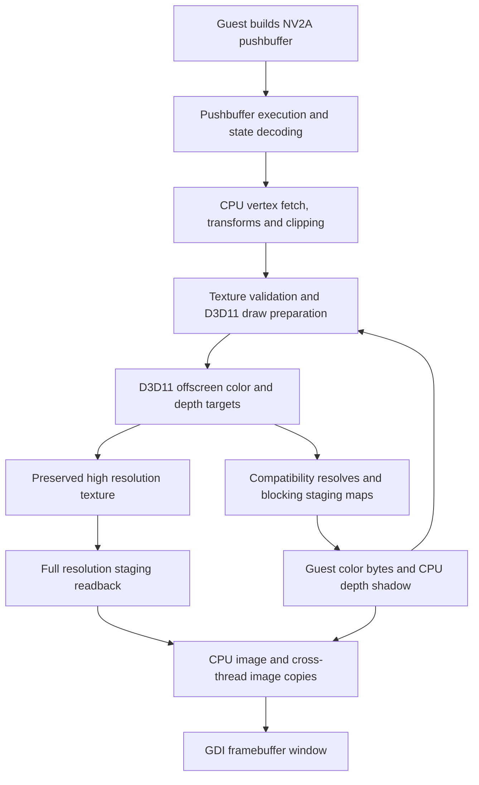

# Graphics pipeline audit

Audit date: 17 October 2026. Source revision: `a502a6fbb50d8ae39c87889525c1318907c15db8`.

The measurements and findings below describe the baseline. See
[optimization progress](GRAPHICS_OPTIMIZATION_PROGRESS.md) for implemented
changes, regression coverage and subsequent measurements.

## Assessment

The current renderer has substantial avoidable transfer and synchronization work. Its main architectural constraint is that GPU rendering repeatedly returns to CPU representations of surfaces, including for presentation. D3D11 is doing the rasterization, but the surrounding pipeline still behaves like a software renderer with hardware batches attached.

This finding concerns the actual DogGame path. An upstream statement that its DirectX implementation is experimental is useful context, but does not identify which subsystem is consuming time here. DogGame maintains significant graphics overrides. The upstream D3D8 wrapper and the NV2A hardware raster backend are different implementations; optimizing the former's swap chain would not fix the latter's framebuffer presentation path.

No rendering behavior was changed during this audit. The findings below distinguish source-established work, measured cost, and proposed replacements that still need correctness validation.

## Active path and coverage

`src/api/title_host_runtime.c` enables `RECOMP_PB_EXEC`, `RECOMP_GPU`, and `RECOMP_FB_WINDOW`. The main route is:



Reviewed boundaries:

| Boundary | Implementation and conclusion |
| --- | --- |
| Submission/dispatch | `nv2a_pb_exec.c`: method handling, draw batches, target/texture changes, clears, flip. `nv2a_pb_scan.c` is an optional observer, not the default renderer. |
| Geometry | `transform_batch_vertices`, `transform_vertex`, `raster_xf_clipped`, `nv2a_vsh_interp.c`: CPU transformation, cache eligibility, clipping and triangle expansion remain in front of hardware rasterization. |
| GPU backend | `nv2a_gpu.cpp`: independent hardware device/context; texture/state caches; target pool; vertex uploads; constant uploads; draw calls; compatibility and presentation readbacks. |
| Surface visibility | `nv_gpu_sync_reason`, `target`, `nv_gpu_texture_barrier`, `preserve_rendered_texture`: CPU/GPU consistency is established conservatively through copies and byte comparisons. |
| Presentation | Flip handling in `nv2a_pb_exec.c` and `fb_present.c`: copied snapshots, locks, CPU composition, GDI display and independent repaint cadence. |
| Alternate D3D8 implementation | Assembled pinned `build/runtime/xboxrecomp/src/d3d/`: separate device, resources, shaders, states and DXGI swap chain. Its `d3d8_present()` is not the `nv_gpu_present_image`/framebuffer route above. Do not attribute both sets of costs to each draw. |
| Video and overlays | Framebuffer PVIDEO composition and debug geometry are additional CPU/display consumers. H001 captures below skip startup movies; video and overlay-heavy cases require separate captures. |

## Runtime evidence

Two **serial** 35-second H001 captures used the same freshly checked Release executable, NVIDIA GeForce RTX 5090, 640x480 window, 4:3 aspect, `FpsCap30=0`, and:

```text
RECOMP_PROFILE_GPU=1
DogGame.exe --debug --nofmv --level H001 --profiler
```

The native case used `InternalScaling=0`. The scaled case used `InternalScaling=1`, `InternalResolution=6` (1920x1080). The executable was copied beside an isolated `display.ini`; existing game assets were reused. Only the test processes were closed. The first overlapping captures shared a debug log and are excluded from the comparison.

Evidence is retained locally in:

- `build/graphics-audit/native-serial/renderer.log`
- `build/graphics-audit/scaled1080-serial/renderer.log`
- `build/graphics-audit/summary.json`
- `build/graphics-audit/run.ps1` (capture procedure)

Both copies have SHA-256 `97579dd409437c976642f71341a6fc3460970edf5f6c76df52591f0d61d55afb`.

The following are the **last emitted cumulative report**, not exact 35-second totals. The processes continue beyond their last periodic report. They cover closely matched draw counts, not a frame-identical benchmark replay.

| Counter | Native | Internal 1920x1080 |
| --- | ---: | ---: |
| D3D11 draw batches | 216,599 | 216,387 |
| Submitted triangles | 27,302,535 | 27,291,013 |
| Synchronization counter | 6,656 | 6,650 |
| Presentation sync calls | 853 | 852 |
| CPU color-clear sync calls | 1,658 | 1,657 |
| Target preparation CPU time | 2,321.8 ms | 3,948.3 ms |
| Submission CPU time | 436.0 ms | 462.8 ms |
| Synchronization CPU time | 2,047.7 ms | 3,327.8 ms |
| High-resolution materializations | 0 | 852 |
| High-resolution bytes materialized | 0 | 6,739.45 MiB |
| High-resolution materialization time | 0 | 380.61 ms |
| Sampled GPU draw mean | 0.0029 ms | 0.0066 ms |

This is about 7.8 synchronization calls per presentation sync. The high-resolution path fetched about 7.91 MiB per materialization: one entire 1920x1080 BGRA image. These high-resolution fetches are **in addition** to the compatibility copies accounted by the sync audit.

For the scaled run, the final sync report attributes 1,820.08 ms to CPU color-clear boundaries, 392.34 ms to presentation boundaries, and 1,113.97 ms to the other five target/sample boundary groups. The time called `wait` includes CPU copying/conversion and API work: it is not a pure GPU wait measurement.

Important interpretation limits:

- Preparation calls synchronization internally. Do **not** add preparation and synchronization totals as independent frame costs.
- `raster_ticks` includes work below the raster batch, including CPU transformation and hardware preparation; it is not a GPU raster duration.
- `bridge/hash` includes target preparation and nested synchronization. It does not isolate texture hashing.
- Timestamp queries sample every 128th operation. Their means are not a complete GPU frame duration or utilization measurement.
- The debug configuration adds logging, timestamp queries, geometry snapshot callbacks, and an offscreen GDI composition pass. These are not shipping-performance FPS figures.
- H001 is an illustrative workload. One powerful GPU and one scene cannot establish worst-case costs, behavior on integrated GPUs, or gains on other hardware.

## Findings, in implementation order

### 1. Highest priority: presentation unnecessarily requires a CPU image

Evidence: `nv2a_gpu.cpp:284-320`, `nv2a_pb_exec.c:3817-3866`, `fb_present.c:276-333,455-505,857-889`.

At a scaled flip, the path can preserve the physical render target with `CopyResource`, resolve a native-sized copy into guest RAM, compare those bytes, copy the preserved physical image to staging, map it, and copy it into `present_pixels`. The publisher copies that high-resolution image again; the window thread copies it again into `s_high_rgb`, then GDI displays it. Native pixels are also copied even when the high-resolution image is available.

The measured scaled run materialized 6.58 GiB before counting the later CPU image copies. Each successful 1080p image publication has three full-resolution CPU copy stages: staging to `present_pixels`, publisher snapshot, window snapshot. At one publication per materialization this is approximately 23.73 MiB of copied image payload per frame, plus the staging transfer and GDI's own consumption; repaint repetitions can add more.

**Direction:** publish a completed GPU image to a D3D11/DXGI presentation path. Keep CPU image materialization as an explicit service for guest CPU access, screenshots, software fallback, video composition paths that still need it, and diagnostics. GPU resource lifetime and thread ownership must be explicit; do not let the UI thread use the immediate context concurrently.

This is an architectural change, not permission to remove guest color synchronization blindly. Presentation and guest visibility need separate contracts.

### 2. Highest priority: render-target ownership is replaced with synchronization

Evidence: `nv2a_gpu.cpp:65-80,554-650,696-815`.

The pool reuses allocations by dimensions. It does not retain independently authoritative contents for every guest surface identity. Changing target commonly means reading old attachments back, preparing CPU representations, then uploading the next attachments. The native capture has 829 calls in each of several target-switch groups.

Even the no-work branch of `nv_gpu_sync_reason()` clears `active.color`. That prevents the next `target()` call from using its same-active-target fast path. A no-op compatibility boundary can therefore invalidate binding/ownership information despite having no dirty result to transfer. CPU mutations still require explicit invalidation; a generic synchronization call should not silently stand in for both operations.

**Direction:** cache resources by guest allocation/layout identity, with independent color/depth ownership, versions and invalidation. Rebinding a known GPU-owned surface should not require an intervening CPU round trip. Handle overlapping/tiled aliases, recycled addresses, scale changes and partial CPU writes. A dimensions-only cache cannot supply that guarantee.

### 3. Highest priority: clears remain CPU operations around GPU work

Evidence: `nv2a_pb_exec.c:725-775,1696-1704,3707-3730`; `nv2a_gpu.cpp:472-489`.

`clear_surface()` synchronizes before checking whether color is requested at all. The clear handler calls it for depth-only clears as well. It then writes pixels on the CPU. `zbuf_clear()` synchronizes and fills the entire 1024x1024 float shadow, even when the current target is smaller. The existing discard helper only avoids readback when it can establish a complete attachment overwrite; that protection is valuable but incomplete.

The scaled workload records 1,657 CPU color-clear boundaries and 1.82 seconds in them. That proves the boundaries matter; it does not prove every byte transferred at them can be discarded. A partial clear still needs untouched contents.

**Direction:** first distinguish actual color/depth writes before requesting synchronization. Next perform supported full clears on GPU resources, retaining lazy CPU shadows. Preserve partial rectangles and channel masks with an appropriate GPU clear/draw implementation. Maintain software fallback for unsupported layouts. Keep unrelated attachment data alive.

### 4. High priority: depth is eagerly read back for a software shadow

Evidence: `nv2a_pb_exec.c:1661-1704,2647`; `nv2a_gpu.cpp:565,580,628-649,787-797`.

The depth pointer passed into this backend comes from `zbuf_current()`'s allocated float shadow. It is not simply the original guest zeta allocation being observed directly. Dirty depth is read back at compatibility boundaries and converted, and later uploaded through staging. Scaled frames additionally preserve/compare a 640x480 native depth snapshot.

**Direction:** separate GPU depth ownership from the software depth shadow. Materialize that shadow when a consumer actually needs it, such as software raster fallback or relevant queries. Keep correct ordering for depth clears, attachment changes and scale changes. Audit all z-buffer consumers before removing synchronization.

The measured H001 hardware-fallback reason counters are zero; that strengthens the case for testing lazy depth materialization here. It is not evidence that every level can eliminate all depth readbacks.

### 5. High priority: rendered textures still pass through guest bytes

Evidence: `nv2a_gpu.cpp:493-538,821-825`; `nv2a_pb_exec.c:2670-2696`.

`rendered_texture_view()` can bind a GPU snapshot, which is good. However, the sampling barrier synchronizes overlapping active targets before lookup; preservation also records native bytes and future reuse validates those bytes with `memcmp`. This often saves texture decoding/upload, while still paying an earlier readback. The native capture shows thousands of snapshot copies and direct bindings, so this optimization is genuinely used but does not make render-to-texture fully GPU-resident.

**Direction:** resolve read/write hazards by surface ownership. For a read-only next use, bind or GPU-copy the prior image as required by D3D11 hazards. Materialize guest bytes only when a CPU observer requires them. Preserve swizzled/linear layout and alias handling.

### 6. High priority: every texture use validates full content

Evidence: `nv2a_pb_exec.c:2560-2615,2670-2696`; `nv2a_gpu.cpp:133-156,827-859`.

The hash cache still `memcmp`s every byte of each cached texture on every draw. A change can trigger comparison, hashing and another copy. Entries above 2 MiB bypass that hash cache. There are 16 hash snapshots versus up to 128 decoded GPU texture entries. Palette bytes also enter paletted-texture hashes. Resident render-target lookup can add another full comparison.

The bridge bucket is substantial, but current measurements do not isolate how much belongs to hashing versus nested target synchronization. Do not label its whole duration as hashing.

**Direction:** count validated bytes, hash misses, changed bytes, palette changes and evictions first. Then introduce reliable write generations/dirty regions covering guest stores, kernel writes, DMA aliases, native video writes and palette mutation. Retain byte validation where writes are not observable. Pointer identity or a once-per-frame hash is not a correctness-preserving replacement.

### 7. Medium/high priority: CPU geometry is expanded before upload

Evidence: `nv2a_pb_exec.c:2206-2240,2512-2544,2703-2828`; `nv2a_gpu.h:10`; `nv2a_gpu.cpp:880-905`.

CPU code fetches/transforms/clips vertices, expands strips/fans/quads into individual triangles, constructs three 116-byte `NvGpuVertex` records per triangle, appends them, and copies them into the dynamic vertex buffer. D3D11 receives `Draw`, not an indexed draw. The native report's 27.3 million triangles imply about 9.50 GB of expanded vertex payload submitted over the reported portion, before counting intermediate CPU copies. This is derived from the vertex structure and triangle counter, not a measured bus counter.

The D3D11 vertex shader largely converts already transformed positions and forwards attributes; switching on GPU rasterization has not moved the guest vertex program to the GPU.

**Direction:** instrument original indices, unique transformed vertices, clipping expansion and upload bytes. Introduce indexed uploads for eligible batches before considering GPU translation of vertex programs. Preserve constant-writing programs, original transform/rounding semantics, flat-shading/provoking-vertex rules, clipping and strip winding. The existing within-batch transform cache already avoids some repeated transforms and must be retained.

### 8. Medium priority: repeated full state submission and constant updates

Evidence: `nv2a_gpu.cpp:142-149,840-905`.

State objects are cached; they are **not created from scratch every draw**. However, descriptors are rebuilt/searched, references are released/reacquired, and nearly every D3D11 binding is resubmitted each batch. A full 496-byte constant buffer is rebuilt and `UpdateSubresource`d even if only a small subset changes. The vertex ring already uses DISCARD/NO_OVERWRITE, which is a good existing choice.

**Direction:** add binding/state-change counters and a context state tracker; separate constant groups by update frequency, or test an appropriate constant-buffer ring. Only merge adjacent batches with identical effective state and no intervening guest-visible boundary. The current H001 submission bucket is much smaller than preparation/synchronization, so this follows the ownership work.

### 9. Medium priority: presentation repaints duplicate frames under a shared lock

Evidence: `fb_present.c:287-333,493-505,857-928`; `src/title_debug_geometry.c:26-30,157-162,299-302`.

The UI loop copies and paints the published image, then sleeps 16 ms. It does not check whether the published frame changed. It holds the shared presentation lock through image copies, overlay composition and GDI drawing; the producer needs the exclusive lock. Debug world registration also selects an extra offscreen GDI composition pass even if trigger/collision drawing returns immediately.

**Direction:** publish a frame sequence/event and repaint on new images or UI invalidation. Acquire ownership of an immutable frame briefly, then release the publication lock before drawing. Preserve matching camera/image snapshots, independent UI input/animation, and the pinned/no-flip fallback. Measure producer lock wait separately from deliberate FPS limiting.

### 10. Medium priority: dirty flags and attachment granularity are coarse

Evidence: `nv2a_gpu.cpp:904-905,554-650`.

Every submitted hardware batch marks color dirty even if its color write mask is zero. Target changes can synchronize attachments beyond the one that the next operation actually observes. Depth-only synchronization is already partially separated, but the general surface lifecycle remains coupled.

**Direction:** track actual enabled attachment writes and next-consumer requirements. A zero color write mask is a useful first deterministic case. Do not infer no writes merely from shader visibility or assumed occlusion.

### 11. Lower priority for steady frames: shader/resource setup and cache churn

Evidence: `nv2a_gpu.cpp:212-260,344-438` and the cache/pool functions above.

Generic and simple pixel shaders compile during initialization, while resolve shaders compile lazily. This can cause startup/first-use stalls. It is not a per-draw compilation loop. Texture changes can create new textures/views rather than update an existing compatible allocation. Resolve source views are retained for one source at a time, so source changes can recreate views. Allocation pools/caches are bounded but do not express a global memory budget.

**Direction:** record shader first-use timing and resource creation/eviction counts, distinguish immutable texture changes from render targets, cache appropriate views with their resources, and expose allocated bytes. Package precompiled fixed shaders after verifying build/distribution requirements. Do not prioritize startup compilation as the explanation for a persistent gameplay slowdown without evidence.

### 12. Audit gap: timings do not fully account for presentation and CPU work

Evidence: `GpuTimer`, `begin_gpu_sample`, `nv_gpu_report`, `nv2a_pb_exec_report`, and the framebuffer loop.

Timing labels overlap, “wait” includes conversion/copying, and there is no complete accounting for texture comparison bytes, target upload bytes, UI lock wait, GDI duration or repeated-frame display. `GpuTimer` itself runs outside the profiling option and obtains performance frequency on each timed operation. The trace mode deliberately forces software fallback in `gpu_begin_batch()`, so trace captures cannot serve as normal hardware performance benchmarks.

**Direction:** add per-frame, non-overlapping CPU spans and explicit byte/operation counters. Sample GPU work asynchronously, retain DONOTFLUSH query collection, and report frame IDs and CPU/GPU ownership transitions. Benchmark with detailed tracing disabled, then measure profiling overhead with it disabled as well. Preserve existing profiling controls without introducing arbitrary percentages.

## Recommended work packages and acceptance tests

1. **Measurement:** per-frame transfer/validation/upload bytes; sync reason and consumer; lock wait; CPU clear work; cache miss/creation counts; actual draw/index counts. Validate counters against synthetic operations and disclose overlap.
2. **Clear/depth lifecycle:** guard no-op attachments, retain GPU-owned depth and full clears, materialize software shadows only on demand. Test full/partial/channel clears, query/fallback transitions, target rebinding and depth sampling comparisons.
3. **Persistent surfaces/rendered textures:** resource identity and independent ownership; GPU-to-GPU sampling paths. Test linear/swizzled aliases, recycled allocations, CPU edits, target sampling and level transitions.
4. **GPU presentation:** separate scanout from guest-memory visibility, make frame lifetime explicit, and replace CPU-image display for GPU-owned frames. Test native/scaled resolution, aspect ratio, video, menu/debug overlays, resize, focus and screenshots. Keep guest operations on their owning thread.
5. **Texture/geometry/state:** introduce write-aware validation, indexed upload where eligible, and state/constant change tracking. Test palette mutation, streamed vertices, constant-writing shaders, clipping, blending order and texture reuse.

Each package needs image comparisons plus representative gameplay across levels, video transitions and saves/loads. Use at least one integrated/older GPU and both compiler builds. Track total frame latency and pacing as well as throughput. Existing tests such as `Check-GpuRaster.py`, `Check-VertexInputs.py`, `Check-VshCacheability.py`, `Check-DisplayResolution.py` and the combiner reference tests provide useful starting coverage; they do not prove the new ownership model correct on their own.

## API references and limits of this audit

The blocking maps above pass flags zero. Microsoft's [Map flags documentation](https://learn.microsoft.com/en-us/windows/win32/api/d3d11/ne-d3d11-d3d11_map_flag) documents the nonblocking alternative and its busy result. Simply adding that flag and ignoring a busy result would display/use incomplete data; scheduling and ownership must change first. Context use also needs the thread discipline described in [Microsoft's D3D11 multithreading guidance](https://learn.microsoft.com/en-us/windows/win32/direct3d11/overviews-direct3d-11-render-multi-thread-intro).

This audit establishes the active path, concrete repeated work, an illustrative runtime cost breakdown and a prioritized redesign. It does not claim an exhaustive GPU event capture, exact speedup, complete upstream implementation review, validation of every graphics feature, or measured coverage of all game scenes. GPU event/pipeline captures and consumer-specific correctness tests remain necessary before removing compatibility work.
